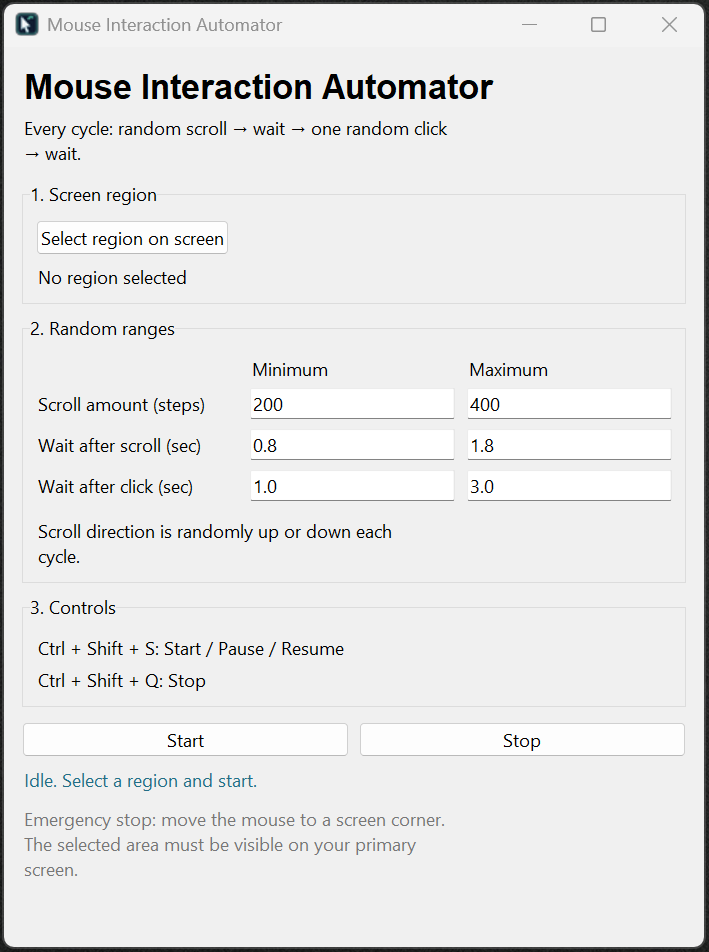

# Mouse Interaction Automator

A Python desktop application for configurable mouse clicks and scrolling within a user-selected area of the screen. The application includes a graphical interface, adjustable random intervals, global keyboard shortcuts, and a Windows installation utility.

## Application Preview



## Features

- **Screen region selection:** Draw a rectangle to define where mouse interactions can occur.
- **Randomized scrolling:** Scroll up or down by a random amount within configured limits.
- **Randomized clicking:** Perform one left click at a random position in the selected region after each scroll.
- **Configurable timing:** Set minimum and maximum delays after scrolling and clicking.
- **Graphical interface:** Change settings without modifying the Python source code.
- **Keyboard shortcuts:** Start, pause, resume, or stop the automation.
- **Windows installer:** Install dependencies, add desktop and Start Menu shortcuts, and launch the application.

## Technologies

- Python 3.10+
- Tkinter for the graphical interface
- PyAutoGUI for mouse control and scrolling
- pynput for global keyboard shortcuts
- PowerShell and Windows batch scripts for installation

## Installation

### Windows: Installer

1. Download the Windows installer ZIP from the repository's **Releases** page, when available.
2. Extract the ZIP file. Do not run the installer directly from inside the ZIP viewer.
3. Double-click `Install.cmd`.
4. Follow any prompts to install Python or required dependencies.
5. Launch **Mouse Interaction Automator** using the desktop or Start Menu shortcut.

The installer checks for Python 3.10 or newer with Tkinter. If needed, it uses Windows Package Manager (`winget`) to install Python 3.13 for the current user. It then creates an application-specific virtual environment and installs the Python dependencies.

**Requirements:** Windows 10 or 11, internet access to install missing dependencies, and `winget` if Python is not already installed. The installer is script-based; it does not produce a standalone `.exe`.

### Manual Python Setup

Install Python 3.10 or newer and make sure Tkinter is available. Clone or download this repository, then run the following commands from the project directory:

**Windows (PowerShell):**

```powershell
py -m pip install -r requirements.txt
py mouse_interaction_automator.py
```

**macOS:**

```bash
python3 -m pip install -r requirements.txt
python3 mouse_interaction_automator.py
```

On macOS, you may need to enable Accessibility permissions for the application running Python. The Windows installer is not compatible with macOS. The macOS setup has not been verified as part of the Windows testing.

## Usage

1. Open the application and select a rectangular screen region.
2. Configure the minimum and maximum scroll amounts.
3. Configure the minimum and maximum delays after scrolling and clicking.
4. Start the automation using the application controls or the keyboard shortcut.
5. The application scrolls, waits, performs **one left click**, waits again, and repeats until paused or stopped.

### Keyboard Shortcuts

| Action | Shortcut |
| --- | --- |
| Start / Pause / Resume | `Ctrl + Shift + S` |
| Stop | `Ctrl + Shift + Q` |
| Emergency fail-safe | Move the mouse pointer to a screen corner |

## Updating or Uninstalling (Windows)

To update an existing installation, run `Install.cmd` again from a newer extracted package. The installer checks dependencies and replaces the application script.

To uninstall, close the application and run `Uninstall.cmd` from the extracted installer folder. The uninstaller removes the application's shortcuts and application-specific files but leaves any shared Python installation in place.

## Limitations and Notes

- Screen region selection currently targets the primary display.
- The application controls the active desktop; moving or resizing windows may change what receives input.
- The application has been tested on Windows 11. Other operating systems have not been verified.
- Only use automated input where it is permitted. Some websites and applications may monitor or restrict automated interactions.

## Project Files

| File | Purpose |
| --- | --- |
| `mouse_interaction_automator.py` | Main Python application |
| `requirements.txt` | Python dependencies |
| `Install.cmd` and `install.ps1` | Windows installer |
| `Uninstall.cmd` and `uninstall.ps1` | Windows uninstaller |
| `app.ico` | Application shortcut and window icon |
| `.gitignore` | Files excluded from version control |

